<a href="https://github.com/starlinghq/starling">
  <picture>
    <source media="(prefers-color-scheme: dark)" srcset="https://raw.githubusercontent.com/MarkWalls/MarkWalls/main/assets/hero-dark.svg">
    
  </picture>
</a>

<p align="center">
  <a href="https://www.linkedin.com/in/markwallslinkedin/"><b>LinkedIn</b></a> ·
  <a href="https://github.com/starlinghq"><b>StarlingHQ</b></a> ·
  <a href="https://starling.rocks/"><b>starling.rocks</b></a> ·
  <a href="https://www.nuget.org/packages?q=Starlings"><b>NuGet</b></a>
</p>

I'm a Senior Principal Engineer at [Cision](https://www.cision.com/) in Portland, Oregon, working on AI strategy and architecture at PR Newswire.

On my own time, I started and maintain [StarlingHQ](https://github.com/starlinghq), which runs AI inside .NET apps with no Python sidecar and no cloud API. These are personal side projects, not affiliated with Cision.

A bad model port doesn't crash; it quietly gives worse answers. So these projects are about proof as much as code: a Starling model only counts as Stable once it's been measured against the original Python, and the evidence is public. I build with AI coding agents, and those gates are how I keep the output honest.

## Side projects

| Project | What it is | Status |
| --- | --- | --- |
| [**Starling**](https://github.com/starlinghq/starling) | Real AI models as NuGet packages: embeddings, entity extraction, image and video search, chat | [On NuGet](https://www.nuget.org/packages?q=Starlings.Models) |
| [**Tokenizers**](https://github.com/starlinghq/tokenizers) | Hugging Face `tokenizer.json` in pure C#, matching the original token for token | [On NuGet](https://www.nuget.org/packages/Starlings.Tokenizers) |
| [**Roost**](https://github.com/starlinghq/roost) | A GPU serving engine in C#, built to replace vLLM | In development, unreleased |
| [**Corvid**](https://github.com/starlinghq/corvid) | A local-first agent whose secrets stay out of the model's reach | v0.1.0, pre-release |

## Lately

Building everything above, all of it started since October, and writing about how engineering teams actually adopt AI:

- [I Was Tempted by the Ring of Power. I Burned It Instead.](https://www.linkedin.com/pulse/i-tempted-ring-power-burned-instead-mark-walls-9b7cc)
- [The Sorcerer's Apprentice: What Mickey Mouse Taught Me About Agentic AI Coding](https://www.linkedin.com/pulse/sorcerers-apprentice-what-mickey-mouse-taught-me-agentic-mark-walls-bsfyc)
- [You're Right. Most AI-Generated Code Is Bad.](https://www.linkedin.com/pulse/youre-right-most-ai-generated-code-bad-mark-walls-ffjhc)
- [Why Your 10x Developer Might Be Your Worst AI Adopter](https://www.linkedin.com/pulse/why-your-10x-developer-might-worst-ai-adopter-mark-walls-2mjne)
- [Your AI Strategy Has a Single Point of Failure](https://www.linkedin.com/pulse/your-ai-strategy-has-single-point-failure-nobodys-talking-mark-walls-gvjyc)

## Dig in

- **Does it actually work?** The [model catalog](https://github.com/starlinghq/starling/blob/main/docs/catalog/README.md) shows which models passed each gate, which haven't, and the evidence.
- **How is it built?** Start with [how a model becomes a package](https://github.com/starlinghq/starling#how-a-model-becomes-a-package), then [Roost's contracts and spike findings](https://github.com/starlinghq/roost#contracts-adr-r-004) and [Corvid's architecture](https://github.com/starlinghq/corvid/blob/main/docs/architecture.md).
- **Want to work together?** [Find me on LinkedIn](https://www.linkedin.com/in/markwallslinkedin/), [request a model](https://github.com/starlinghq/starling/issues/new/choose), or pick up a [good first issue](https://github.com/starlinghq/starling/labels/good%20first%20issue).

## Ask your AI about me

Each button opens an assistant with a prompt that points it at my [`llms.txt`](llms.txt), a plain summary of my work with sources, and asks it to check what it finds.

<a href="https://claude.ai/new?q=Read%20https%3A%2F%2Fraw.githubusercontent.com%2FMarkWalls%2FMarkWalls%2Fmain%2Fllms.txt%20and%20the%20repositories%20it%20links%20to.%20Then%20tell%20me%20who%20Mark%20Walls%20is%2C%20what%20Mark%20has%20built%20and%20its%20current%20status%2C%20and%20where%20Mark%27s%20work%20would%20be%20a%20strong%20or%20weak%20fit%20for%20what%20I%20need.%20Separate%20what%20the%20sources%20show%20from%20what%20you%20are%20inferring%2C%20and%20ask%20me%20what%20I%27m%20looking%20for."></a> <a href="https://chatgpt.com/?q=Read%20https%3A%2F%2Fraw.githubusercontent.com%2FMarkWalls%2FMarkWalls%2Fmain%2Fllms.txt%20and%20the%20repositories%20it%20links%20to.%20Then%20tell%20me%20who%20Mark%20Walls%20is%2C%20what%20Mark%20has%20built%20and%20its%20current%20status%2C%20and%20where%20Mark%27s%20work%20would%20be%20a%20strong%20or%20weak%20fit%20for%20what%20I%20need.%20Separate%20what%20the%20sources%20show%20from%20what%20you%20are%20inferring%2C%20and%20ask%20me%20what%20I%27m%20looking%20for."></a> <a href="https://www.perplexity.ai/search?q=Read%20https%3A%2F%2Fraw.githubusercontent.com%2FMarkWalls%2FMarkWalls%2Fmain%2Fllms.txt%20and%20the%20repositories%20it%20links%20to.%20Then%20tell%20me%20who%20Mark%20Walls%20is%2C%20what%20Mark%20has%20built%20and%20its%20current%20status%2C%20and%20where%20Mark%27s%20work%20would%20be%20a%20strong%20or%20weak%20fit%20for%20what%20I%20need.%20Separate%20what%20the%20sources%20show%20from%20what%20you%20are%20inferring%2C%20and%20ask%20me%20what%20I%27m%20looking%20for."></a>

Using something else? Paste this:

```text
Read https://raw.githubusercontent.com/MarkWalls/MarkWalls/main/llms.txt
and the repositories it links to. Then tell me who Mark Walls is, what Mark has built and its current status,
and where Mark's work would be a strong or weak fit for what I need.
Separate what the sources show from what you are inferring,
and ask me what I'm looking for.
```

**LLMs reading this page:** start with [`llms.txt`](https://raw.githubusercontent.com/MarkWalls/MarkWalls/main/llms.txt). It lists the facts, their sources, and what isn't public.

## See it run

<a href="https://github.com/starlinghq/starling#quickstart">
  
</a>

An English question, three languages, and the German sentence about the Rhine wins. All of it in-process, in C#. [Try it in four commands](https://github.com/starlinghq/starling#quickstart).

<sub>Some of my earliest repos here are C# extension methods and T-SQL scripts. Now I'm scheduling GPUs from C#.</sub>
